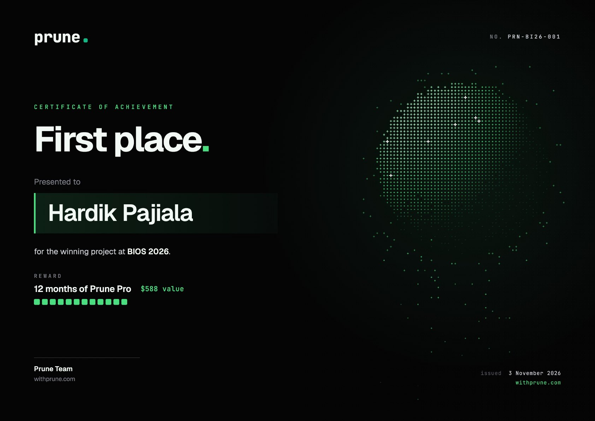
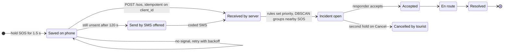

<a href="https://pajiala99.github.io">
  <picture>
    <source media="(prefers-color-scheme: dark)" srcset="assets/header-dark.svg?v=4">
    
  </picture>
</a>

  
  
  

  <a href="#whoami"><kbd>&nbsp;whoami&nbsp;</kbd></a>
  <a href="#results"><kbd>&nbsp;Results&nbsp;</kbd></a>
  <a href="#selected-builds"><kbd>&nbsp;Selected builds&nbsp;</kbd></a>
  <a href="#how-an-sos-survives-no-signal"><kbd>&nbsp;SOS lifecycle&nbsp;</kbd></a>
  <a href="#all-projects"><kbd>&nbsp;All projects&nbsp;</kbd></a>
  <a href="#toolkit"><kbd>&nbsp;Toolkit&nbsp;</kbd></a>

## whoami

| | |
|---|---|
| **Education** | B.E. Computer Engineering, Thapar Institute of Engineering & Technology, 2024–2028 |
| **Based in** | Patiala, India |
| **Works on** | Backend APIs · data pipelines on Spark and Delta Lake · ML models · AI agents with guardrails |
| **Currently** | Open to software, data and ML internships |
| **Reach me** | [Portfolio](https://pajiala99.github.io) · [LinkedIn](https://linkedin.com/in/hardik-pajiala) · [hardikpajiala@gmail.com](mailto:hardikpajiala@gmail.com) |

<picture>
  <source media="(prefers-color-scheme: dark)" srcset="assets/stats-dark.svg?v=4">
  
</picture>

## Results

| Result | Event |
|---|---|
| 🏆 **First place** | **BIOS 2026 hackathon**, Thapar Institute · built [SafeTrail](https://github.com/pajiala99/BIOS-SafeTrail) in a team of two, as the top contributor · [certificate](assets/certificate-bios-2026.jpg) |
| 🧩 **Team entry** | **Smart India Hackathon**, problem statement SIH26003 (Ministry of DoNER) · built [Smriti](https://github.com/urgirlgeet/Smriti), a memory and care companion for elders with dementia |
| 🤖 **Agents track** | **Homingo Hackathon** · built [PRAMAAN](https://github.com/pajiala99/pramaan), an AI agent that investigates recruitment scams |

🎖️ <b>View the first-place certificate</b>

 

## Selected builds

Each card replays the idea its project is built around. Click a card to open the repo.

  <a href="https://github.com/pajiala99/BIOS-SafeTrail"><picture><source media="(prefers-color-scheme: dark)" srcset="assets/card-safetrail-dark.svg?v=4"></picture></a>
  <a href="https://github.com/pajiala99/cricket-winprob-lakehouse"><picture><source media="(prefers-color-scheme: dark)" srcset="assets/card-cricket-dark.svg?v=4"></picture></a>

  <a href="https://github.com/pajiala99/project_SE3"><picture><source media="(prefers-color-scheme: dark)" srcset="assets/card-foodbridge-dark.svg?v=4"></picture></a>
  <a href="https://github.com/pajiala99/academic-timetable-generator"><picture><source media="(prefers-color-scheme: dark)" srcset="assets/card-timetable-dark.svg?v=4"></picture></a>

## How an SOS survives no signal

SafeTrail's SOS path, from the button to a resolved incident. Drag or zoom the diagram.

The server answers the moment an SOS arrives, and priority and grouping are plain rules. The AI writes the incident report afterwards, and nothing on this path waits for it.

## All projects

<b>SafeTrail</b> · 🏆 First place, BIOS 2026 · trail safety that works without signal

 

A trail-safety app for treks and pilgrimages. I was the top contributor in a team of two.

- 📍 Geofenced danger zones: entering one sets off an alarm, a spoken warning and a red frame
- 📶 An SOS that is saved on the phone and sent when signal returns, with SMS as a fallback
- 🗺️ A responder view with a live map, SOS grouped into incidents, and signed passes checked offline
- 🛡️ The AI is never in the emergency path. It only writes and translates text, under a per-job budget, with a standard fallback
- 📊 Benchmarked four builds: 82% fewer AI tokens per trip than a naive build

`FastAPI` `React` `TypeScript` `MapLibre` `Server-Sent Events` `pytest` · [**Repository →**](https://github.com/pajiala99/BIOS-SafeTrail) · [**Certificate →**](assets/certificate-bios-2026.jpg)

<b>Smriti</b> · Smart India Hackathon, SIH26003 · dementia care for North East India

 

A memory and care companion for elders with dementia in North East India, built by our team for the Ministry of DoNER problem statement.

- 🕰️ Elder screen: a large orientation clock, read-aloud, family voice messages and a one-tap SOS
- 🥁 Culturally local games, like a Bihu rhythm game, with an Assamese folk-flute sound synthesised in the browser
- 📈 Caregiver dashboard: engagement and sundowning charts, routine pace and a geofence map
- 📱 Offline Flutter tablet build: a hearing screen, an adaptive memory game and a decline alert

`React` `TypeScript` `Web Audio API` `Flutter` `SQLite` · [**Web app →**](https://github.com/urgirlgeet/Smriti) · [**Flutter app →**](https://github.com/khushidangi/Smriti)

<b>PRAMAAN</b> · Homingo Hackathon, Agents track · an AI agent that checks job offers

 

- 🔎 Claude plans the investigation across 5 tools: red-flag rules, domain age, lookalike domains, careers pages and a web search for scam reports
- ⚖️ The model never decides. Fixed rules over cited evidence give the verdict, and it never calls a scam on one source alone
- 🧪 61 tests, including a prompt-injection test

`Python` `Claude API` `Tool use` `Streamlit` · [**Repository →**](https://github.com/pajiala99/pramaan)

<b>Cricket Win-Probability Lakehouse</b> · 1.67M ball-by-ball rows

 

- 🏗️ A bronze/silver/gold Delta Lake lakehouse built from 7,000+ nested JSON files in 180 s
- 🔁 Exactly-once streaming ingestion and revision-safe MERGE upserts, guarded by 19 data-quality checks
- 🎯 A Spark MLlib win-probability model: 0.777 AUC and 1.8 pp calibration error on unseen seasons, scored live

`PySpark` `Delta Lake` `Structured Streaming` `Spark MLlib` `Airflow` · [**Repository →**](https://github.com/pajiala99/cricket-winprob-lakehouse)

<b>FoodBridge</b> · backend and matching engine

 

- 🔌 26 REST endpoints over a 10-table PostgreSQL/PostGIS schema, with JWT auth and state machines
- 🧮 A FastAPI matcher that scores donor–shelter pairs and assigns them with the Hungarian algorithm

`Node.js` `TypeScript` `PostgreSQL` `PostGIS` `FastAPI` · [**Repository →**](https://github.com/pajiala99/project_SE3)

<b>Indian Sign Language Recognition</b> · webcam signs to speech

 

- ✋ A BiLSTM with attention on MediaPipe keypoints that recognises 61 signs live and speaks them
- 🧪 Went beyond a saturated benchmark: 94.5% top-1 from just 5 examples per word

`PyTorch` `MediaPipe` `BiLSTM` · [**Repository →**](https://github.com/pajiala99/isl-recognition)

<b>Academic Timetable Generator</b> · graph colouring meets scheduling

 

- 🧩 Clique and Hall's-theorem checks prove when no timetable can exist, before any search
- 🔍 Backtracking meets every hard constraint, then simulated annealing improves the soft ones

`Java` `JavaFX` `MySQL` · [**Repository →**](https://github.com/pajiala99/academic-timetable-generator)

## Toolkit

  
  
  
  
  
  
  
  
  
  
  
  
  
  
  
  
  

The header, the stats card and the project cards are drawn by <a href="scripts/build_assets.py">scripts/build_assets.py</a>; a GitHub Action refreshes the stats daily. Off the keyboard: Batch Group Leader for a 300-student batch at Thapar, Saturnalia volunteer, gym, running, music and anime.
