<a href="https://pajiala99.github.io">
  <picture>
    <source media="(prefers-color-scheme: dark)" srcset="assets/header-dark.svg">
    
  </picture>
</a>

  
  
  

  <a href="#hackathons">🏆 Hackathons</a> ·
  <a href="#projects">🛠️ Projects</a> ·
  <a href="#tech">🧰 Tech</a> ·
  <a href="#activity">📈 Activity</a> ·
  <a href="https://pajiala99.github.io">💬 Ask the guide on my portfolio</a>

<picture>
  <source media="(prefers-color-scheme: dark)" srcset="assets/stats-dark.svg">
  
</picture>

## Hackathons

<b>SafeTrail</b> · BIOS V2, problem statement winner 🏆 · <i>click to fold</i>

 

A trail-safety app for treks and pilgrimages. I was the top contributor in a team of two.

- 📍 Geofenced danger zones: entering one sets off an alarm, a spoken warning and a red frame
- 📶 An SOS that is saved on the phone and sent when signal returns, with SMS as a fallback
- 🗺️ A responder view with a live map, SOS grouped into incidents, and signed passes checked offline
- 🛡️ The AI is never in the emergency path. It only writes and translates text, under a per-job budget, with a standard fallback
- 📊 Benchmarked four builds: 82% fewer AI tokens per trip than a naive build

`FastAPI` `React` `TypeScript` `MapLibre` `Server-Sent Events` `pytest` · [**Repository →**](https://github.com/pajiala99/BIOS-SafeTrail)

<b>Smriti</b> · Smart India Hackathon, SIH26003 · <i>click to expand</i>

 

A memory and care companion for elders with dementia in North East India, built by our team for the Ministry of DoNER problem statement.

- 🕰️ Elder screen: a large orientation clock, read-aloud, family voice messages and a one-tap SOS
- 🥁 Culturally local games, like a Bihu rhythm game, with an Assamese folk-flute sound synthesised in the browser
- 📈 Caregiver dashboard: engagement and sundowning charts, routine pace and a geofence map
- 📱 Offline Flutter tablet build: a hearing screen, an adaptive memory game and a decline alert

`React` `TypeScript` `Web Audio API` `Flutter` `SQLite` · [**Web app →**](https://github.com/urgirlgeet/Smriti) · [**Flutter app →**](https://github.com/khushidangi/Smriti)

<b>PRAMAAN</b> · Homingo Hackathon, Agents track · <i>click to expand</i>

 

An AI agent that investigates job offers for recruitment scams.

- 🔎 Claude plans the investigation across 5 tools: red-flag rules, domain age, lookalike domains, careers pages and a web search for scam reports
- ⚖️ The model never decides. Fixed rules over cited evidence give the verdict, and it never calls a scam on one source alone
- 🧪 61 tests, including a prompt-injection test

`Python` `Claude API` `Tool use` `Streamlit` · [**Repository →**](https://github.com/pajiala99/pramaan)

## Projects

<b>Cricket Win-Probability Lakehouse</b> · 1.67M ball-by-ball rows · <i>click to expand</i>

 

- 🏗️ A bronze/silver/gold Delta Lake lakehouse built from 7,000+ nested JSON files in 180 s
- 🔁 Exactly-once streaming ingestion and revision-safe MERGE upserts, guarded by 19 data-quality checks
- 🎯 A Spark MLlib win-probability model: 0.777 AUC and 1.8 pp calibration error on unseen seasons, scored live

`PySpark` `Delta Lake` `Structured Streaming` `Spark MLlib` `Airflow` · [**Repository →**](https://github.com/pajiala99/cricket-winprob-lakehouse)

<b>FoodBridge</b> · backend and matching engine · <i>click to expand</i>

 

- 🔌 26 REST endpoints over a 10-table PostgreSQL/PostGIS schema, with JWT auth and state machines
- 🧮 A FastAPI matcher that scores donor–shelter pairs and assigns them with the Hungarian algorithm

`Node.js` `TypeScript` `PostgreSQL` `PostGIS` `FastAPI` · [**Repository →**](https://github.com/pajiala99/project_SE3)

<b>Indian Sign Language Recognition</b> · webcam signs to speech · <i>click to expand</i>

 

- ✋ A BiLSTM with attention on MediaPipe keypoints that recognises 61 signs live and speaks them
- 🧪 Went beyond a saturated benchmark: 94.5% top-1 from just 5 examples per word

`PyTorch` `MediaPipe` `BiLSTM` · [**Repository →**](https://github.com/pajiala99/isl-recognition)

<b>Academic Timetable Generator</b> · graph colouring meets scheduling · <i>click to expand</i>

 

- 🧩 Clique and Hall's-theorem checks prove when no timetable can exist, before any search
- 🔍 Backtracking meets every hard constraint, then simulated annealing improves the soft ones

`Java` `JavaFX` `MySQL` · [**Repository →**](https://github.com/pajiala99/academic-timetable-generator)

## Tech

  
  
  
  
  
  
  
  
  
  
  
  
  
  
  
  
  

## Activity

<picture>
  <source media="(prefers-color-scheme: dark)" srcset="https://raw.githubusercontent.com/pajiala99/pajiala99/output/snake-dark.svg">
  
</picture>

Batch Group Leader for a 300-student batch at Thapar · Saturnalia volunteer · off the keyboard: gym, running, music and anime. The images above refresh daily through a GitHub Action in this repo.
